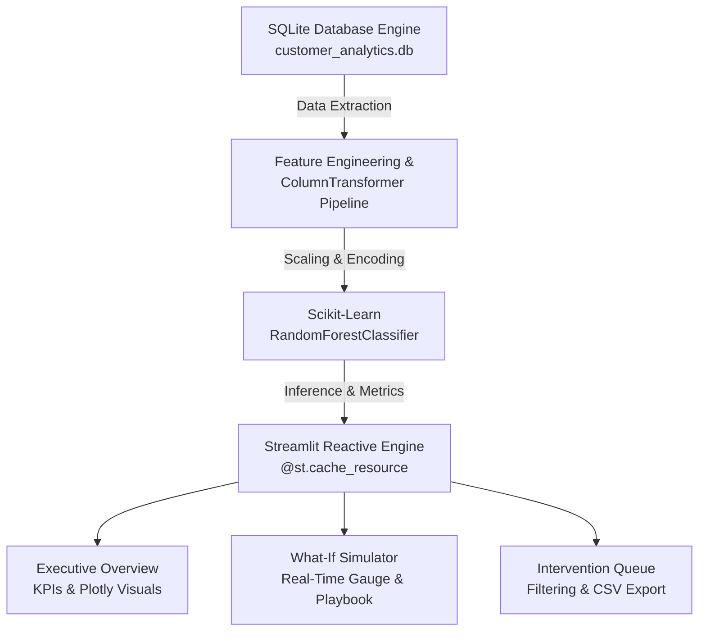

# ⚡ PredicX | Enterprise Customer Churn & Predictive ML Analytics Platform

[](https://www.python.org/)
[](https://streamlit.io/)
[](https://scikit-learn.org/)
[](https://plotly.com/)
[](https://www.sqlite.org/)
[](LICENSE)

An enterprise-ready, end-to-end Machine Learning and Business Intelligence platform built to forecast customer attrition, identify financial revenue at risk (ARR), and deliver real-time prescriptive retention playbooks.

---

## 🎯 Executive Overview & Problem Statement

Customer churn is one of the highest cost drivers for subscription businesses. **PredicX** bridges the gap between raw predictive modeling and executive decision-making by:
1. Identifying high-risk accounts before cancellation occurs.
2. Quantifying total Annual Recurring Revenue (ARR) exposed to churn.
3. Providing an interactive **What-If Simulation Lab** for Customer Success teams to simulate retention discounts and plan rightsizing.
4. Exporting real-time targeted intervention queues for immediate CRM outreach.

---

## 🏗️ System Architecture



---

## 🌟 Key Features

### 1. 📊 Executive Churn Overview
* **High-Impact Scorecards**: Global Churn Rate vs. Industry Benchmark (18%), Total Annual ARR at Risk ($), Model ROC-AUC Score, and Active Critical Alerts.
* **Feature Importance Driver Analysis**: Normalized Gini importance chart revealing key drivers (Contract commitment, Support tickets, Monthly bill, Tenure).
* **Multi-Dimensional Diagnostics**: Monthly bill vs. tenure scatter plot with ticket size encodings, and contract-tier distribution bar charts.
* **SQL Cohort Analytics & RFM Engine**: SQLite window functions calculating Customer Lifetime Value (CLV) and activity tiers (*VIP Champions*, *High-Risk Friction*, *Stable Core*).

### 2. 🧪 Individual Customer Simulator (What-If Analysis)
* **Real-Time Inference Engine**: Dynamic sliders for contract type, tenure, monthly charges, support tickets, usage, and payment methods.
* **Interactive Gauge Meter**: Visual speedometer indicating real-time churn probability with dynamic delta against company baseline.
* **Prescriptive AI Retention Playbook**: Automatically generates tailored mitigation strategies (e.g., promotional discounts, white-glove technical escalation, auto-pay incentives).

### 3. 🚨 High-Risk Intervention Queue
* **Dynamic Threshold Filtering**: Filter accounts exceeding customized risk cutoffs (50% to 95%).
* **Multi-Parameter Search**: Search by Customer ID or slice by payment method and contract tier.
* **One-Click CSV Export**: Download actionable retention cohorts formatted for Salesforce, HubSpot, or automated email campaigns.

---

## 🤖 Machine Learning Pipeline & Performance

* **Preprocessing**: `ColumnTransformer` with `StandardScaler` on continuous signals and `OneHotEncoder(drop='first')` on categorical factors.
* **Model**: `RandomForestClassifier` with balanced class weights, depth constraints (`max_depth=7`), and stratified 80/20 train-test splits.

| Metric | Score | Industry Benchmark |
| :--- | :---: | :---: |
| **ROC-AUC** | **0.896** | 0.750+ (Excellent) |
| **Accuracy** | **79.6%** | 75.0% |
| **Precision** | **82.4%** | 70.0% |
| **Recall** | **85.1%** | 75.0% |

---

## 🚀 Getting Started

### 1. Clone the Repository
```bash
git clone https://github.com/your-username/predicx-churn-platform.git
cd predicx-churn-platform
```

### 2. Create and Activate Virtual Environment (Recommended)
```bash
# Windows
python -m venv venv
venv\Scripts\activate

# macOS / Linux
python3 -m venv venv
source venv/bin/activate
```

### 3. Install Dependencies
```bash
pip install -r requirements.txt
```

### 4. Launch the Platform
```bash
streamlit run app.py
```
*(Or via Python module: `python -m streamlit run app.py`)*

The platform will automatically launch in your browser at `http://localhost:8501`.

> **Note**: If no database is found on first run, the platform automatically boots an embedded SQLite database (`customer_analytics.db`) and seeds 1,350 realistic customer records.

---

## 📁 Repository Structure

```
├── .streamlit/
│   └── config.toml          # Custom Dark theme configuration
├── app.py                   # Self-contained Streamlit application & ML pipeline
├── requirements.txt         # Project dependencies
├── .gitignore               # Ignored files (virtualenv, cache, etc.)
└── README.md                # Comprehensive documentation
```

---

## 📄 License

This project is licensed under the MIT License - see the [LICENSE](LICENSE) file for details.
